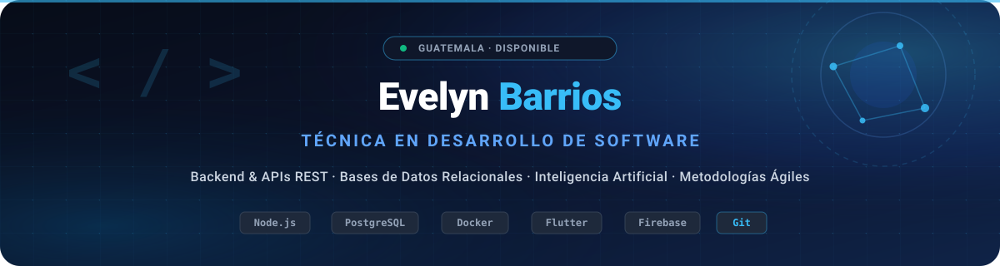

  

  
  
  
  

  <strong>Técnica en Desarrollo de Software · Backend &amp; APIs · Bases de Datos · Inteligencia Artificial</strong> 
  Guatemala (GMT-6) · Disponible para oportunidades laborales

---

### Sobre mí

Hola, soy **Evelyn Barrios**, Técnica en Desarrollo de Software graduada de **Campuslands Guatemala**, con especialidad en desarrollo backend, diseño de bases de datos relacionales e inteligencia artificial.

Mi camino hacia la tecnología tiene una base práctica y analítica: soy **Perito Contador** y cursé estudios de **Administración de Empresas** en la Universidad de San Carlos de Guatemala (USAC). Además, durante tres años trabajé en servicio al cliente, coordinación de sucursales comerciales y seguimiento de métricas operativas. Esta trayectoria me enseñó una regla fundamental: **antes de escribir una sola línea de código, hay que saber escuchar, comprender el proceso y entender el problema real del usuario y del negocio.**

Me considero una persona metódica, analítica y constante. Me apasionan la arquitectura modular y la creación de sistemas intuitivos, seguros y limpios. Actualmente divido mi jornada entre el desarrollo intensivo de software, la coordinación técnica y comercial, y el apoyo docente como auxiliar en talleres de Inteligencia Artificial los fines de semana.

---

### Stack Tecnológico y Herramientas

  <strong>Backend &amp; APIs REST:</strong> 
  
  
  
  
  
  

  <strong>Bases de Datos Relacionales &amp; Cloud:</strong> 
  
  
  
  
  

  <strong>Frontend &amp; Desarrollo Mobile:</strong> 
  
  
  
  
  
  
  

  <strong>Testing, DevOps &amp; Herramientas:</strong> 
  
  
  
  
  
  
  

---

### Proyectos Destacados

| Proyecto | Rol y Aporte Técnico | Stack Tecnológico | Enlaces |
| :--- | :--- | :--- | :---: |
| **OMS Backend (Softplus)** | **Liderazgo Técnico & Backend:** Modernización del sistema de gestión de órdenes. Diseñé y normalicé 26 tablas relacionales en PostgreSQL (3NF). Implementé validaciones, manejo centralizado de errores, Redis y WebSockets (tiempo real), Docker y testing de endpoints con Bruno y Postman. | `Node.js` `Express` `Strapi` `PostgreSQL` `Redis` `WebSockets` `Docker` `Bruno` `Postman` | [Repositorio en GitHub](https://github.com/barriosevelyn488-web/evelyn-oms-backend) |
| **Alba (Salud Farma-Geriátrica)** | **Desarrolladora Móvil & Organización:** Aplicación móvil en equipo de 12 desarrolladores. Arquitectura limpia en Flutter conectada a Firebase, detección de caídas en segundo plano con giroscopio/acelerómetro, roles por QR y estándares WCAG AAA. Organización inicial de entregas del equipo. | `Flutter` `Dart` `Firebase` `Provider` `SQLite` `WCAG AAA` `Scrum` | [Repositorio en GitHub](https://github.com/barriosevelyn488-web/proyecto_alba_guatemala) |
| **KarenFlix (Full-Stack)** | **Desarrolladora Full-Stack & Scrum:** Plataforma de catálogo cinematográfico y reseñas. Desarrollé el frontend web interactivo y la API RESTful modular por capas (Node.js/Express) con MySQL 8 en la nube, autenticación segura con JWT HttpOnly y Swagger UI. | `Node.js` `Express` `MySQL 8` `JavaScript` `Swagger UI` `JWT` `Vercel` | [App en Vivo](https://karenflix-frontend.vercel.app) · [Swagger UI](https://karenflix-backend.vercel.app/api-docs) · [Repo](https://github.com/barriosevelyn488-web/Karenflix_backend) |
| **Librarian (ACME Store)** | **Desarrolladora Full-Stack (POO & SOLID):** Solución de comercio y gestión bibliotecaria bajo Clean Architecture (4 capas desacopladas) y principios SOLID. Frontend responsivo con Tailwind CSS conectado a Open Library API, SQLite en 3NF y pasarela de préstamos/ventas. | `Clean Architecture` `SOLID` `Node.js` `SQLite 3NF` `Tailwind CSS` `JWT` | [App en Vivo](https://acme-store-frontend.vercel.app/) · [Repo](https://github.com/barriosevelyn488-web/librarian-backend) |
| **Campus Parking** | **Desarrolladora Frontend:** Automatización del control operativo de parqueadero construida con JavaScript Vanilla (ES6+) modular y manipulación directa del DOM, maquetación responsiva y persistencia en localStorage sin librerías externas. | `JavaScript ES6+` `HTML5` `CSS3` `localStorage` | [Demo en Vivo](https://barriosevelyn488-web.github.io/campus_parking_proyecto/DOCSHTML/login.html) · [Repo](https://github.com/barriosevelyn488-web/campus_parking_proyecto) |
| **Campuslands CRM & AI Academy** | **Desarrolladora Full-Stack:** Herramienta CRM para seguimiento de prospectos a talleres de IA con tablero Kanban de seis etapas, base relacional en Supabase (PostgreSQL) y sincronización con Google Sheets. | `Next.js` `TypeScript` `Supabase` `PostgreSQL` `Google Sheets` | [Repositorio en GitHub](https://github.com/barriosevelyn488-web/proyecto_ia_academy) |
| **TutorBot para Telegram** | **Backend & Automatización:** Chatbot académico automatizado que procesa registros de estudiantes mediante formularios web, webhooks de n8n, API de Telegram y Docker Compose. | `Node.js` `n8n` `Docker` `Telegram Bot API` | [Formulario en Vivo](https://barriosevelyn488-web.github.io/Proyecto_TutorBot_evelyn-barrios_Carlos-Velasco/) · [Repo](https://github.com/barriosevelyn488-web/Proyecto_TutorBot_evelyn-barrios_Carlos-Velasco) |

---

### Habilidades Adaptativas & Liderazgo

- **Liderazgo Técnico (OMS Backend):** Coordinación del equipo backend para cumplir fechas de entrega, definición de arquitectura y revisión de endpoints.
- **Organización y Gestión de Entregas (Proyecto Alba):** Asignación de tareas, estructuración de roles y coordinación de la primera entrega y presentación en un equipo de 12 desarrolladores.
- **Escucha Activa y Acompañamiento (AI Academy y Ventas):** Auxiliar docente en talleres de IA resolviendo bloqueos en tiempo real; escucha de requerimientos reales de usuarios.
- **Resolución Metódica de Problemas:** Enfoque analítico para modelar 26 tablas relacionales en 3NF, centralizar manejo de errores y estabilizar sistemas bajo presión.
- **Trabajo Colaborativo en Git & Scrum:** Gestión ágil de historias de usuario, ramas de características, pull requests y revisión de código.

---

### Formación Académica & Trayectoria

- **Técnico en Desarrollo de Software** — Campuslands GT | Zona 4, Guatemala *(2026)*
- **Administración de Empresas** — Universidad de San Carlos de Guatemala (USAC) *(2024 · Segundo semestre)*
- **Perito Contador con Orientación en Computación** — Instituto por Cooperativa de Villa Hermosa *(★ Alumna Destacada)*

---

### Actividad y Estadísticas en GitHub

  <!-- Gráfico dinámico de actividad y curva de contribuciones en el tiempo -->
  

 

  <!-- Racha de contribuciones y días activos -->
  
  &nbsp;&nbsp;
  <!-- Distribución de lenguajes en repositorios -->
  

  <a href="https://barriosevelyn488-web.github.io/portafoliohtml/">Explorar Portafolio Completo</a> ·
  <a href="mailto:barrios.evelyn.488@gmail.com">Contactar por Correo</a>

